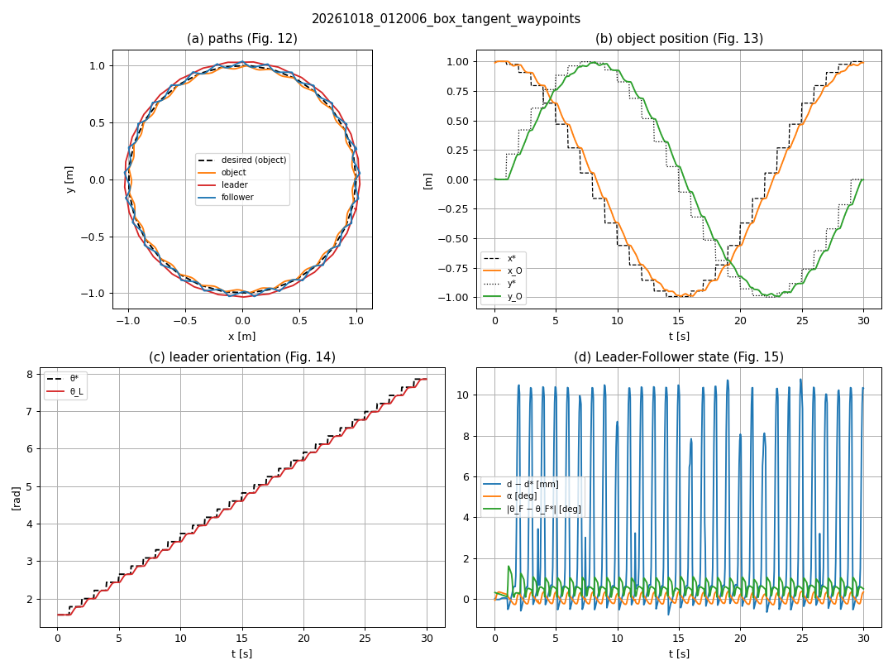

# caging_multirobot_ros2

**Cooperative object transport with two omnidirectional robots: a step-by-step ROS 2 / Gazebo
reproduction of a caging-based multi-robot controller.**

Two mecanum (omnidirectional) robots with soft grippers approach an object, trap it between them
(**caging**) and carry it along a trajectory, using an **LQR** pose controller per robot and a
**Leader-Follower** formation controller. The project reproduces in simulation the work of
Tejada et al. (2025) ([doi:10.1007/s10846-025-02263-y](https://doi.org/10.1007/s10846-025-02263-y)),
with ROS 2 Jazzy, Gazebo Harmonic and `ros2_control`.

It is teaching material for undergraduate and postgraduate students of robotics (Mechatronics
Engineering, Universidad EIA), and an open simulation baseline for anyone working on multi-robot
caging.



## Two ways in

### 1. Run it (Docker, no ROS 2 installation)

The finished simulator runs in a container: Gazebo and RViz with the GUI, the unit tests and the
four experiments of Table 2 headless. Only Docker is needed, on Linux or on Windows (WSL2).

- **Students**: [docker/kit/STUDENT_GUIDE.md](docker/kit/STUDENT_GUIDE.md): install Docker, pull
  the image `ghcr.io/ddrozo31/caging_multirobot_ros2`, run the demos.
- **Build the image yourself** or develop inside the container:
  [docker/README.md](docker/README.md).

Requirements: an **x86-64** computer (Intel or AMD; ARM is not supported yet), 4 cores / 8 threads
(laptop H series or desktop, 2018 or newer), 8 GB of memory on Linux or 16 GB on Windows, hardware
OpenGL 3.3, 20 GB of free disk. Details and measured speeds in the student guide.

### 2. Build it step by step

The project was built in 13 steps, each one a lecture or lab with its own guide. The history of
this repository has **one commit and one tag per step**, so you can see the code exactly as it was
after each step:

```bash
git clone https://github.com/ddrozo31/caging_multirobot_ros2.git
cd caging_multirobot_ros2
git tag                                   # step-00 … step-12, docker, v1.0
git switch -c my-work step-00             # start your own work from Step 0
git diff step-04 step-05 -- src           # what Step 5 added to the code
```

Start with [Step 0](docs/steps/step_00_workspace_setup.md) (installation of ROS 2 Jazzy, Gazebo
Harmonic and the workspace, Ubuntu 24.04). The guides in every tag are their final, corrected
version.

## Course index

| Step | Topic | Paper reference | Guide |
|------|-------|-----------------|-------|
| 0 | Workspace setup | – | [step_00_workspace_setup.md](docs/steps/step_00_workspace_setup.md) |
| 1 | Mecanum robot model in Gazebo Harmonic | §2.1.1 | [step_01_robot_model.md](docs/steps/step_01_robot_model.md) |
| 2 | Mecanum kinematics: custom ros2_control controller | Eq. 1–4 | [step_02_mecanum_controller.md](docs/steps/step_02_mecanum_controller.md) |
| 3 | Pose feedback: ground truth ("virtual Vicon") and wheel odometry | §2.5, Eq. 3, 5 | [step_03_pose_feedback.md](docs/steps/step_03_pose_feedback.md) |
| 4 | LQR pose controller for one robot | Eq. 5–12 | [step_04_lqr_controller.md](docs/steps/step_04_lqr_controller.md) |
| 5 | Two robots and the objects (namespaces) | §2.5, Fig. 9–10 | [step_05_two_robots.md](docs/steps/step_05_two_robots.md) |
| 6 | Object approach: approach poses and A* | §2.3, Eq. 13 | [step_06_approach_astar.md](docs/steps/step_06_approach_astar.md) |
| 7 | Soft gripper and object closure (caging) | §2.1.2, Table 1 | [step_07_gripper_caging.md](docs/steps/step_07_gripper_caging.md) |
| 8 | Leader-Follower controller (keeping the object caged) | §2.4, Eq. 14–25 | [step_08_leader_follower.md](docs/steps/step_08_leader_follower.md) |
| 9 | Transporting the object along a trajectory | §2.4.2, §2.5, Eq. 26–27 | [step_09_trajectory.md](docs/steps/step_09_trajectory.md) |
| 10 | Full task, safety, logging and results vs. Table 2 | §2.1, §3 | [step_10_task_and_results.md](docs/steps/step_10_task_and_results.md) |
| 11 | Repeatability (noisy virtual Vicon, 5 runs) and object retention | §3 | [step_11_repeatability.md](docs/steps/step_11_repeatability.md) |
| 12 | Single source of the robot dimensions (controller reads the URDF) | Eq. 1 | [step_12_single_source.md](docs/steps/step_12_single_source.md) |

Supporting material:

- [Paper reference](docs/paper_reference.md): the equations, parameters and robot dimensions used.
- [Inside the mecanum controller](docs/steps/step_02_controller_walkthrough.md): C++ and
  ros2_control walkthrough for non-C++ users (companion to Step 2).
- [The math of LQR, step by step](docs/steps/step_04_lqr_math.md): matrix toolkit, Riccati
  derivation and worked examples (companion to Step 4).
- [Methodology](docs/methodology.md): how the project was organized (step loop, review gates,
  decision log, git conventions, verification, packaging), reusable for similar projects.

## Results

The whole experiment runs with one command (`ros2 launch caging_bringup task.launch.py
auto_start:=true`). Mean errors with the **box**, compared with Table 2 of the paper (details,
figures and discussion in [Step 10](docs/steps/step_10_task_and_results.md)):

| | $e_{d_O}$ [m] | $e_{\theta_L}$ [rad] | $e_d$ [m] | $e_\alpha$ [rad] |
|---|---|---|---|---|
| Paper, experiment 1 (static orientation) | 0.10 | 0.08 | 0.01 | 0.06 |
| This simulation, paper's waypoints | 0.103 | 0.000 | 0.003 | 0.007 |
| This simulation, smooth reference | 0.047 | 0.000 | 0.000 | 0.003 |
| Paper, experiment 2 (orientation tangent to the circle) | 0.13 | 0.15 | 0.01 | 0.09 |
| This simulation, paper's waypoints | 0.105 | 0.069 | 0.003 | 0.003 |
| This simulation, smooth reference | 0.046 | 0.045 | 0.001 | 0.000 |

**Repeatability and retention ([Step 11](docs/steps/step_11_repeatability.md)).** With a noisy
virtual Vicon (σ = 2 mm, 0.3°) and 5 runs per configuration, the results change by at most 2 mm
between runs (e.g. $e_{d_O}$ = 0.103 ± 0.001 m in experiment 1 with waypoints), all 20 runs
finished, and the object was **retained in 20/20 runs**: it never moved more than 17.5 mm from the
midpoint of the robots (abort limit 50 mm).

**Scope.** Only the box is reproduced (14 of the 42 values of Table 2), with experiments 1 (static)
and 2 (tangent). The hemisphere, the pyramid and the leader-first closure are left as student
exercises (Steps 7 and 10).

## Repository layout

```
caging_multirobot_ros2/
├── README.md, LICENSE (Apache-2.0), LICENSE-docs (CC BY 4.0), CITATION.cff
├── src/                          # colcon workspace: the five ROS 2 packages
│   ├── caging_description/       #   robot xacro, V-gripper, objects, RViz configs
│   ├── caging_gazebo/            #   worlds, ROS-Gazebo bridge, spawn launch files
│   ├── caging_mecanum_controller/#   C++ ros2_control controller (mecanum kinematics, Eq. 1)
│   ├── caging_control/           #   the paper's algorithms: core/ (pure Python), nodes/ (ROS 2)
│   └── caging_bringup/           #   launch files, parameters (Table 1), experiment scripts
├── docker/                       # image, Compose services, student kit and guide
└── docs/
    ├── steps/                    # the 13 step guides and two companions
    ├── paper_reference.md        # equations and parameters used
    ├── methodology.md            # how the project was organized
    ├── figures/                  # robot drawing, result plots
    └── data/                     # logged results used in the guides
```

Stack: ROS 2 Jazzy, Gazebo Harmonic, `ros2_control` + `gz_ros2_control`, Python 3 (`rclpy`,
`numpy`) for the nodes and the math, C++ only for the mecanum controller.

## How to cite

If you use this repository, please cite it (see [CITATION.cff](CITATION.cff); GitHub shows a
"Cite this repository" button) and the paper it reproduces:

- D. Rozo-Osorio, *caging_multirobot_ros2: cooperative object transport with two omnidirectional
  robots in ROS 2 and Gazebo*, Universidad EIA, 2026.
  https://github.com/ddrozo31/caging_multirobot_ros2
- J. C. Tejada, A. Toro-Ossaba, M. A. López-Quintero, D. Rozo-Osorio, A. López-González,
  E. G. Hernández-Martínez, M. Góngora, I. Bonet Cruz, "Enhancing Object Manipulation and
  Transportation in Multi-Robot Systems with Soft Gripper Integration and Caging-Based Control",
  *Journal of Intelligent & Robotic Systems*, vol. 111, art. 76, 2025.
  https://doi.org/10.1007/s10846-025-02263-y

## License

- **Code** (`src/`, `docker/`): [Apache License 2.0](LICENSE).
- **Documentation and figures** (`docs/`, this README): [Creative Commons Attribution 4.0
  International](LICENSE-docs) (CC BY 4.0).

## Author

**David Rozo-Osorio, I.M., M.Sc.**, david.rozo31@eia.edu.co
Universidad EIA, Envigado, Colombia. Mechatronics Engineering, Robotics.

Work done by the author with AI assistance.
