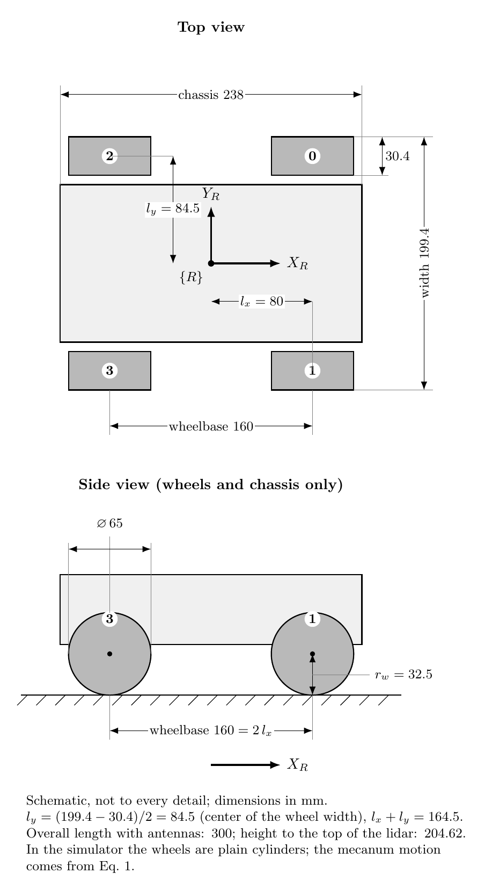

# Paper Reference — Tejada et al. (2025)

Quick reference of the equations, parameters and robot data needed to reproduce
*"Enhancing Object Manipulation and Transportation in Multi-Robot Systems with Soft Gripper
Integration and Caging-Based Control"*, J. Intelligent & Robotic Systems (2025) 111:76,
https://doi.org/10.1007/s10846-025-02263-y (read the full text from the publisher).

Equation numbers match the paper. Where the printed equation seems to contain a typo, it is
copied **as printed** and a note explains the interpretation used in this course (exception:
Eq. 18, whose left-hand side is shown corrected; see its note).

---

## 1. Task stages (§2.1, Fig. 2)

1. **Starting stage** – robots placed away from the object.
2. **Object approach** – each robot reaches an approach pose without collisions (A* + LQR).
   Robots move sequentially: leader first, then follower.
3. **Object closure (caging)** – robots move forward until the object is trapped between the
   soft grippers.
4. **Object transport** – the follower switches from LQR to the Leader-Follower controller;
   the leader keeps its LQR as the trajectory tracker of the whole system.

---

## 2. Robot kinematics (§2.1.3)

**Forward kinematics of the mecanum robot (Eq. 1)**

$$
\begin{bmatrix}\dot x_R\\ \dot y_R\\ \dot\theta\end{bmatrix}
=\frac{r_w}{4}
\begin{bmatrix}
1 & 1 & 1 & 1\\
-1 & 1 & 1 & -1\\
-\frac{1}{l_x+l_y} & \frac{1}{l_x+l_y} & -\frac{1}{l_x+l_y} & \frac{1}{l_x+l_y}
\end{bmatrix}
\begin{bmatrix}\dot\theta_0\\ \dot\theta_1\\ \dot\theta_2\\ \dot\theta_3\end{bmatrix}
\tag{1}
$$

- $\dot x_R$: forward velocity, $\dot y_R$: lateral velocity, $\dot\theta$: angular velocity (robot frame {R}).
- $\dot\theta_i$, $i=\{0,1,2,3\}$: wheel velocities. Numbering from Fig. 6 of the paper:
  **0 = front-left, 1 = front-right, 2 = rear-left, 3 = rear-right** ($X_R$ forward, $Y_R$ left).
  A positive $\dot\theta_i$ on every wheel drives the robot forward (row 1 of Eq. 1).
- $r_w$: wheel radius; $l_x$: center → front/rear axle; $l_y$: center → lateral wheels.

**State-space form (Eq. 2)**

$$\dot q_R = J_R\,\mu,\qquad q_R=[\dot x_R,\dot y_R,\dot\theta]^T,\quad \mu=[\dot\theta_0,\dot\theta_1,\dot\theta_2,\dot\theta_3]^T \tag{2}$$

**Rotation to the global frame {G} (Eq. 3)**

$$
R(\theta)=\begin{bmatrix}\cos\theta & -\sin\theta & 0\\ \sin\theta & \cos\theta & 0\\ 0&0&1\end{bmatrix}
\tag{3}
$$

**Global kinematics (Eq. 4)**

$$\dot q_G = R(\theta)J_R\,\mu = H(\theta)\,\mu \tag{4}$$

---

## 3. Discretization (§2.1.4)

**Backward Euler (Eq. 5)**

$$x_{(k)} = x_{(k-1)} + \dot x(t)\,T_s \tag{5}$$

**Discrete model (Eq. 6)**

$$q_{G(k)} = A\,q_{G(k-1)} + B(\theta)\,\mu_{(k-1)},\qquad A=I_{3\times3},\quad B(\theta)=T_s H(\theta) \tag{6}$$

> Note: the paper defines $T_s$ but never gives its value. We use $T_s = 0.05$ s.

---

## 4. LQR controller (§2.2)

**Feedback linearization (Eq. 7)**

$$\mu = B(\theta)^{-1}\,v \tag{7}$$

> Note: $B(\theta)$ is 3×4, so $B^{-1}$ is understood as the (right) pseudo-inverse $B^{+}$.

**Linearized system (Eq. 8)**

$$q_{G(k)} = A_l\,q_{G(k-1)} + B_l\,v_{(k-1)},\qquad A_l=B_l=I_{3\times3} \tag{8}$$

**Cost function (Eq. 9)**

$$J(q,v)=\sum_{k=0}^{\infty}\left(q_{(k)}^T Q\,q_{(k)} + v_{(k)}^T R\,v_{(k)}\right) \tag{9}$$

**Control law (Eq. 10)**

$$v = K\,(q^* - q_G),\qquad K=[k_x,k_y,k_\theta] \tag{10}$$

**Gain (Eq. 11)**

$$K = (R + B_l^T P B_l)^{-1} B_l^T P A_l \tag{11}$$

**Discrete algebraic Riccati equation (Eq. 12)**

$$P = A_l\left(P - P B_l (B_l^T P B_l + R)^{-1} B_l^T P\right)A_l + Q \tag{12}$$

---

## 5. Object approach (§2.3, Fig. 7)

- A* generates a collision-free path for each robot to its approach pose.
- Approach distance: $d_a = 2r_o + l_g$ ($r_o$: object radius, $l_g$: robot center → gripper center).

**Approach poses (Eq. 13)**

$$
q_L^*=\begin{bmatrix}x_L^*\\y_L^*\\\theta_L^*\end{bmatrix}
=\begin{bmatrix}x_O\\y_O\\\theta_O\end{bmatrix}
+d_a\begin{bmatrix}-\cos\theta_O\\-\sin\theta_O\\0\end{bmatrix},
\qquad
q_F^*=\begin{bmatrix}x_F^*\\y_F^*\\\theta_F^*\end{bmatrix}
=\begin{bmatrix}x_O\\y_O\\\theta_O\end{bmatrix}
+d_a\begin{bmatrix}\cos\theta_O\\\sin\theta_O\\-\pi/d_a\end{bmatrix}
\tag{13}
$$

> Note: the third row gives $\theta_F^* = \theta_O - \pi$, i.e. the follower faces the leader.

---

## 6. Leader-Follower caging controller (§2.4, Fig. 8)

**Kinematics of each robot (Eq. 14)**

$$\dot q_r = R(\theta_r)\,u_r,\qquad r=\{L,F\},\quad u_r=[\dot x_r,\dot y_r,\dot\theta_r]^T \tag{14}$$

**Formation state:** $\eta=[d,\alpha,\theta_F]^T$, with $d_x=x_L-x_F$, $d_y=y_L-y_F$.

$$d = |\vec d| = \sqrt{(x_L-x_F)^2+(y_L-y_F)^2}=\sqrt{d_x^2+d_y^2} \tag{15}$$

$$\alpha = \theta_F - \operatorname{atan2}\!\left(\frac{y_L-y_F}{x_L-x_F}\right) \tag{16}$$

**Time derivatives (Eq. 17–20)**

$$\dot d = \frac{d_x\dot d_x + d_y\dot d_y}{d} \tag{17}$$

$$\dot\alpha = \dot\theta_F - \frac{d_x\dot d_y + d_y\dot d_x}{d^2} \tag{18}$$

> Note: printed as "$\dot d = \dots$"; from context it is $\dot\alpha$, so the left-hand side
> above is corrected (the right-hand side is as printed). The sign of the
> second term is also misprinted: $\dot\alpha = \dot\theta_F - \frac{d_x\dot d_y - d_y\dot d_x}{d^2}$
> (derivative of atan2). Matrices $A$, $B$ of Eq. 21 are correct (checked numerically, Step 8).

$$\dot d_x = \dot x_L\cos\theta_L - \dot y_L\sin\theta_L - \dot x_F\cos\theta_F + \dot y_F\sin\theta_F \tag{19}$$

$$\dot d_y = \dot x_L\sin\theta_L + \dot y_L\cos\theta_L - \dot x_F\sin\theta_F - \dot y_F\cos\theta_F \tag{20}$$

**Formation model (Eq. 21)**, using $d_x=d\cos(\theta_F-\alpha)$, $d_y=d\sin(\theta_F-\alpha)$:

$$\dot\eta = A(d,\alpha,\theta_F,\theta_L)\,u_L - B(d,\alpha)\,u_F \tag{21}$$

$$
A=\begin{bmatrix}\cos\gamma & -\sin\gamma & 0\\ -\frac1d\sin\gamma & -\frac1d\cos\gamma & 0\\ 0&0&0\end{bmatrix},\qquad
B=\begin{bmatrix}\cos\alpha & -\sin\alpha & 0\\ -\frac1d\sin\alpha & -\frac1d\cos\alpha & -1\\ 0&0&-1\end{bmatrix},\qquad
\gamma=\theta_L-\theta_F+\alpha
$$

**Control law (Eq. 22) and desired polynomial (Eq. 23)**

$$u_F = B^{-1}\left(A\,u_L - p_d\right) \tag{22}$$

$$
p_d=\begin{bmatrix}\dot d^* - k_d(d-d^*)\\ \dot\alpha^* - k_\alpha(\alpha-\alpha^*)\\ \dot\theta_F^* - k_{\theta_F}(\theta_F-\theta_F^*)\end{bmatrix}
\tag{23}
$$

References: $d^* = r_O$ (radius of the circle circumscribing the object), $\alpha^*=0$,
$\theta_F^*=\theta_L-\pi$; therefore $\dot d^*=0$, $\dot\alpha^*=0$, $\dot\theta_F^*=\dot\theta_L$.

> Note: the text says $d^* = r_O$, but Table 1 uses $d^* = 0.52$ m with $r_O = 0.15$ m.
> 0.52 m is consistent with a center-to-center distance (robot + gripper + object).
> **Resolved in Step 7: $d^* = 0.52$ m** (gripper center at $0.26 - l_g = 0.14 \approx r_O$).

**Stability (Eq. 24–25)**

$$\dot e = \dot\eta - \dot\eta^*,\qquad e=[d-d^*,\ \alpha-\alpha^*,\ \theta_F-\theta_F^*]^T \tag{24}$$

$$\dot e = -K e,\qquad K=\operatorname{diag}\{k_d,k_\alpha,k_{\theta_F}\} \tag{25}$$

$-K$ is Hurwitz if $k_d,k_\alpha,k_{\theta_F}>0$, so $e\to 0$ as $t\to\infty$.

**Control point translation (Eq. 26–27)** — the system is controlled from the object center:

$$
\begin{bmatrix}x_L^*\\y_L^*\\\theta_L^*\end{bmatrix}
=\begin{bmatrix}x_O^*\\y_O^*\\\theta_O^*\end{bmatrix}
+\frac d2\begin{bmatrix}-\cos\theta_L^*\\-\sin\theta_L^*\\0\end{bmatrix}
\tag{26}
$$

$$q_L^* = q_{MRS}^* + \frac d2\,U(\theta_L^*),\qquad q_{MRS}^*=q_O^*,\quad U(\theta_L^*)=[-\cos\theta_L^*,-\sin\theta_L^*,0]^T \tag{27}$$

---

## 7. Experiment parameters (§2.5, Table 1)

| Algorithm | Parameter | Value |
|-----------|-----------|-------|
| Initial positions | $q_O$ | $[0,\ 0,\ \pi]^T$ |
| | $q_L$ | $[0.5,\ -2.5,\ \pi/2]^T$ |
| | $q_F$ | $[-0.5,\ -2.5,\ \pi/2]^T$ |
| Object approach | $r_O$ | 0.15 m |
| | $l_g$ | 0.12 m |
| LQR controller | $Q$ | $0.1\,I_{3\times3}$ |
| | $R$ | $0.8\,I_{3\times3}$ |
| Leader-Follower controller | $d^*$ | 0.52 m |
| | $\alpha^*$ | 0 |
| | $k_d$ | 2 |
| | $k_{\theta_F}$ | 1 |
| | $k_\alpha$ | 1 |

**Trajectories (object transport stage)**

- Waypoints: $\phi_i = \dfrac{2\pi i}{N-1}$, $i=\{0,\dots,N-1\}$, $N=30$; trajectory completed in 30 s.
- Experiment 1 (static orientation): $q_{MRS}^* = [\cos\phi_i,\ \sin\phi_i,\ \pi]^T$
- Experiment 2 (tangent orientation): $q_{MRS}^* = [\cos\phi_i,\ \sin\phi_i,\ \operatorname{atan2}(y_{MRS},x_{MRS})]^T$
  > Note: on a circle centered at the origin, $\operatorname{atan2}(y, x) = \phi_i$ is the **radial**
  > direction; the text says **tangent** ($\phi_i + \pi/2$). Step 9 implements both.

**Objects (Fig. 10)**

| # | Object | Size |
|---|--------|------|
| 1 | Box | 0.2 × 0.2 × 0.2 m |
| 2 | Hemisphere | radius 0.1 m |
| 3 | Three-sided pyramid (rounded edges) | base edge 0.15 m, height 0.15 m |

**Reported metrics (Table 2):** mean Euclidean error of the object position $e_{d_O}$, MAE of
$x_O$, $y_O$, $\theta_L$, $d$, $\alpha$, $\theta_F$ — for both experiments and all objects.

---

## 8. Robot: Yahboom ROSMASTER X3

Own schematic drawing from the manufacturer's published dimensions (TikZ source:
[figures/rosmaster_x3_dimensions.tex](figures/rosmaster_x3_dimensions.tex), also as
[PDF](figures/rosmaster_x3_dimensions.pdf)).

| Measure (drawing) | Value |
|-------------------|-------|
| Wheel diameter | 65 mm |
| Wheelbase (front–rear axle distance) | 160 mm |
| Overall width (outer wheel faces) | 199.40 mm |
| Wheel width | 30.40 mm |
| Chassis length | 238 mm |
| Overall length (with antennas) | 300 mm |
| Ground → lower deck | 71.25 mm |
| Lower deck → upper deck | 60 mm |
| Upper deck → top of lidar | 55 mm |
| Height to top of lidar / overall height | 204.62 mm / 262.25 mm |

**Derived kinematic parameters (for Eq. 1)**

| Parameter | Derivation | Value |
|-----------|-----------|-------|
| $r_w$ | 65 / 2 | 0.0325 m |
| $l_x$ | 160 / 2 | 0.080 m |
| $l_y$ | (199.40 − 30.40) / 2 | 0.0845 m |
| $l_x + l_y$ | | 0.1645 m |

Real setup (context only): 4 mecanum wheels with 12 V DC gearmotors, Raspberry Pi 4
(Ubuntu 22.04). Poses from a Vicon system (6 Vero cameras, 3 × 6 m area), centralized laptop,
ROS 2 Humble over WiFi. Gripper: Fin-Ray TPU fingers, PLA frame, SG5010 servo (6.5 kg·cm).
