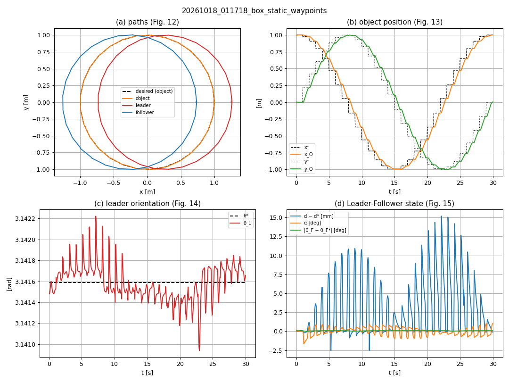
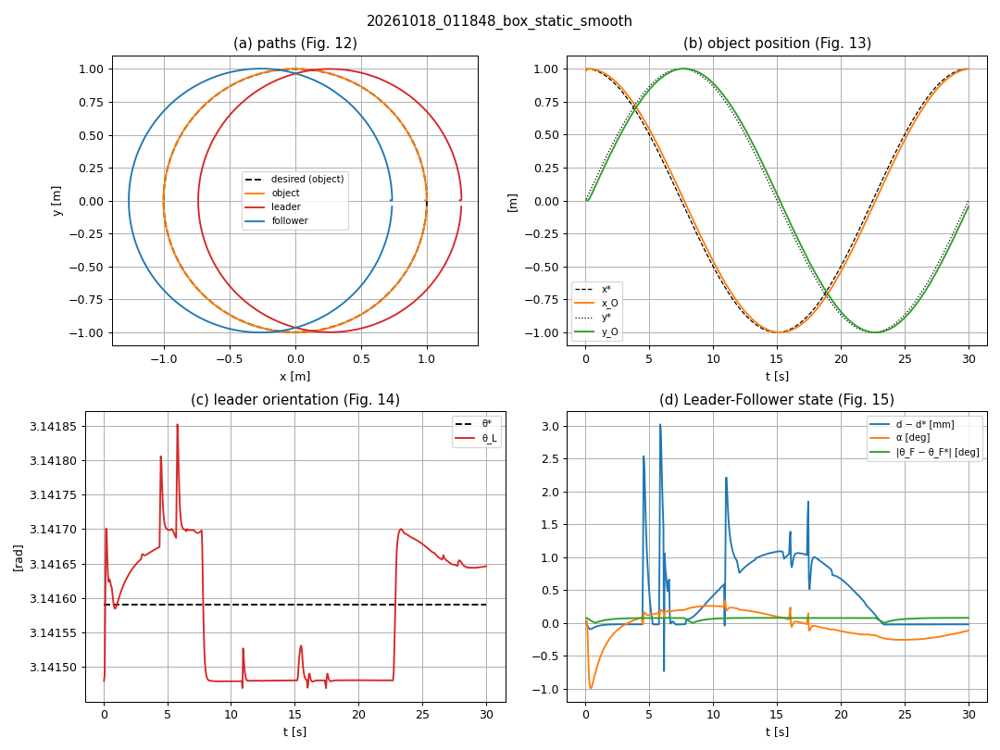
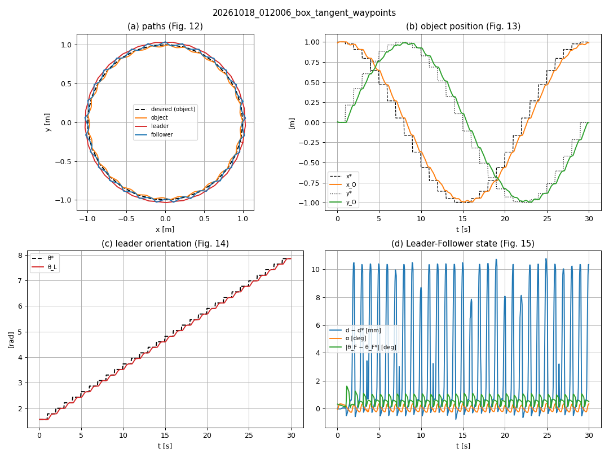
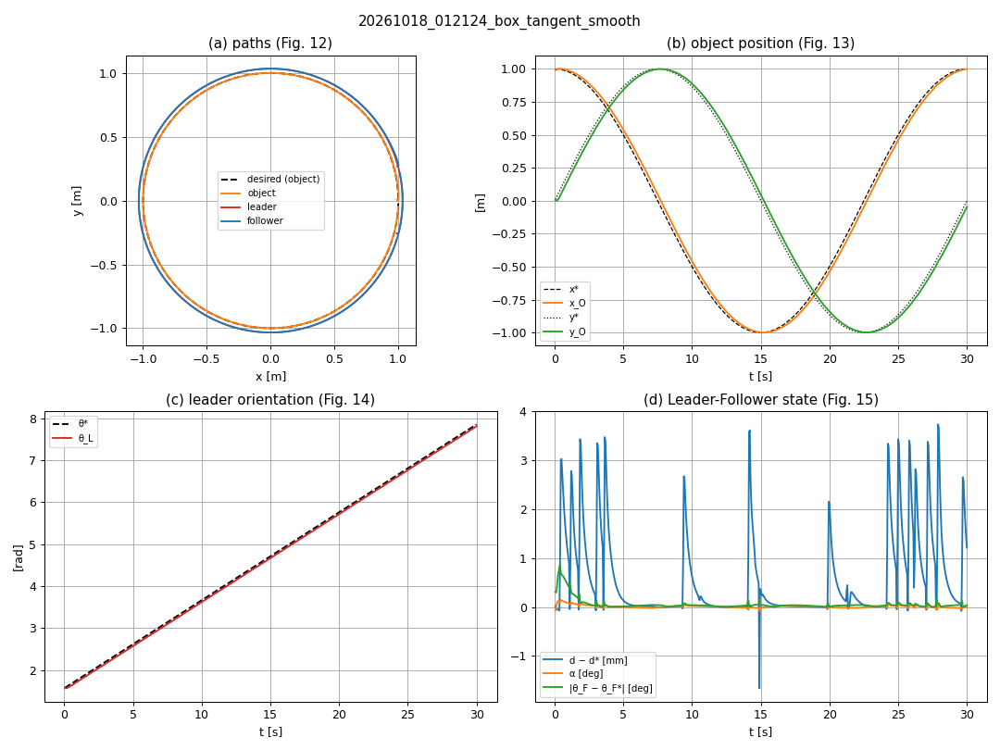

# Step 10 — The Whole Task, Safety, Logging and Results

## Objective

Put all the stages together and reproduce the experiments of the paper:

1. a **state machine** runs the whole task with one command:
   approach → closure → transport → trajectory;
2. a **safety supervisor** stops **both** robots if anything goes wrong;
3. every lap is **logged** to a CSV file, and a script draws the equivalents of the paper's
   Fig. 12–15 and the error table (Table 2);
4. a **batch script** runs the experiments headless and we compare our results with the paper.

Tested with the **box** (the hemisphere and the pyramid are prepared but not tested: they are left
as a student exercise).

## Paper reference

- §2.1 — the four stages of the task; §2.5 — experimental procedure.
- §3 — Fig. 12–15 (paths, object position, leader orientation, Leader-Follower state) and
  Table 2 (mean errors).

## Theory

### 1. The task as a state machine

```
          /start_task
   IDLE ──────────────► APPROACH ──► CLOSURE ──► TRANSPORT ──► TRAJECTORY ──► DONE
                           │            │            │              │
                           └────────────┴──── failure or /safety/abort ───► ABORTED
```

| State | Entered when | Left when | Who does the work |
|---|---|---|---|
| APPROACH | `/start_task` (or `auto_start`) → call `/start_approach` | `/approach/stage` = `closure` | `approach_manager` (A\*, LQR) |
| CLOSURE | | `/object_closed` = true | `approach_manager` |
| TRANSPORT | object closed (follower in Leader-Follower) | after 2 s → call `/start_trajectory` | `leader_follower` |
| TRAJECTORY | transfer + one lap | `/trajectory/finished` = true | `trajectory_tracker` |
| DONE / ABORTED | | | |

`task_manager` does not move anything: it only calls the services of Steps 6–9 and listens to
their topics. Each stage is still a node you can run and test alone. The current state is
published on `/task_state`.

### 2. Safety: stop BOTH robots

Each mecanum controller stops **its own** robot when its commands stop (Step 5). But the object
is held by **two** robots: if one stops and the other keeps going, the cage opens. So
`safety_supervisor` aborts the task if:

| Check | When | Limit |
|---|---|---|
| (a) ground truth of leader, follower and object is fresh | whole task | 0.5 s |
| (b) each robot receives commands | TRANSPORT, TRAJECTORY | 0.5 s |
| (c) object close to the midpoint of the robots (cage) | TRANSPORT, TRAJECTORY | 5 cm |
| (d) formation distance error $\|e_d\|$ | TRANSPORT, TRAJECTORY | 3 cm |

**Abort:** set `active = false` on both LQRs and on the Leader-Follower → no node sends
commands → after 0.5 s the timeout of **each** mecanum controller stops **each** robot;
`/safety/abort = true` → `task_manager` goes to ABORTED.

(b) is checked only when both robots are driven all the time: during the approach the waiting
robot receives no commands, which is normal.

### 3. Logging and plots

At the end of each lap `trajectory_tracker` writes
`results/<date>_<object>_<orientation>_<reference>.csv` (20 Hz): time, poses of the object,
leader and follower, desired pose, $d$, $\alpha$ and every error of Table 2. `results/` is not
in git (generated data).

`plot_results` (pure Python + matplotlib, in `caging_control/tools/`) draws one figure per lap
with four panels — (a) paths (Fig. 12), (b) $x_O$, $y_O$ vs. time (Fig. 13), (c) $\theta_L$ vs.
time (Fig. 14), (d) $d - d^*$, $\alpha$, $\theta_F$ error (Fig. 15) — and with `--table` a Markdown
table of the mean errors next to Table 2.

### 4. Other objects (prepared, not tested)

The closing distance $d^*$ makes the object just touch both V grippers (120°, apex at
$l_g = 0.12$ m from the robot center):

| Object | Grasp | Apex – object center | $d^* = 2(\text{apex} + l_g)$ | grasp_offset |
|---|---|---|---|---|
| Box | corner in the apex | $0.1\sqrt2 = 0.141$ m | 0.523 m (Table 1: **0.52**) | π/4 |
| Hemisphere | tangent to both fingers | $0.1/\sin 60° = 0.115$ m | 0.471 m | 0 |
| Pyramid | follower: corner; leader: face (its corners touch the fingers) | 0.087 m | 0.413 m | 0 |

With Table 1's $d^* = 0.52$ m for all objects, the hemisphere would rattle 4.9 cm and the pyramid
10.7 cm inside the cage: only the box fits Table 1 exactly. The table is in
`caging_bringup/launch/caging.launch.py` (`OBJECTS`); `object:=hemisphere` or `pyramid` uses it.

## Files created / changed

```
src/
├── caging_control/
│   ├── caging_control/nodes/task_manager.py       # NEW: state machine, /start_task, /task_state
│   ├── caging_control/nodes/safety_supervisor.py  # NEW: checks (a)-(d), stops both robots
│   ├── caging_control/nodes/approach_manager.py   # + /approach/stage
│   ├── caging_control/nodes/trajectory_tracker.py # + CSV per lap, /trajectory/finished
│   ├── caging_control/tools/plot_results.py       # NEW: figures (Fig. 12-15) and table
│   ├── setup.py, package.xml                      # + task_manager, safety_supervisor,
│   │                                              #   plot_results, python3-matplotlib
├── caging_bringup/
│   ├── launch/task.launch.py                      # NEW: everything + task_manager + supervisor
│   ├── launch/caging.launch.py                    # + object argument, OBJECTS table
│   ├── launch/trajectory.launch.py                # + object, results_dir
│   └── scripts/run_experiments.sh                 # NEW: batch of headless runs
├── .gitignore                                     # + /results
docs/figures/step10_box_*.png                      # NEW: figures of the four runs
```

## How to build and run

```bash
cd ~/caging_multirobot_ros2
colcon build
source install/setup.bash

# One experiment with the GUIs
ros2 launch caging_bringup task.launch.py orientation:=static reference:=smooth
ros2 service call /start_task std_srvs/srv/Trigger          # or add auto_start:=true
ros2 topic echo /task_state

# All the box experiments headless (about 6 min), then plots + table
bash src/caging_bringup/scripts/run_experiments.sh
ros2 run caging_control plot_results results/*.csv --table
```

`run_experiments.sh` accepts `OBJECTS`, `ORIENTATIONS` and `REFERENCES`, e.g.
`ORIENTATIONS=radial REFERENCES=smooth bash src/caging_bringup/scripts/run_experiments.sh`.

## Results

### Our Table 2 (box, taken by the corners)

Mean errors over the 30 s lap; batch of 20261018, all four runs ended in DONE.

| Run | $e_{d_O}$ [m] | $e_{x_O}$ [m] | $e_{y_O}$ [m] | $e_{\theta_L}$ [rad] | $e_d$ [m] | $e_{\theta_F}$ [rad] | $e_\alpha$ [rad] |
|---|---|---|---|---|---|---|---|
| **Paper, box, experiment 1** | **0.10** | **0.07** | **0.06** | **0.08** | **0.01** | **0.09** | **0.06** |
| Exp. 1 (static), paper's waypoints | 0.103 | 0.065 | 0.066 | 0.000 | 0.003 | 0.001 | 0.007 |
| Exp. 1 (static), smooth reference | 0.047 | 0.030 | 0.030 | 0.000 | 0.000 | 0.001 | 0.003 |
| **Paper, box, experiment 2** | **0.13** | **0.09** | **0.07** | **0.15** | **0.01** | **0.10** | **0.09** |
| Exp. 2 (tangent), paper's waypoints | 0.105 | 0.067 | 0.067 | 0.069 | 0.003 | 0.010 | 0.003 |
| Exp. 2 (tangent), smooth reference | 0.046 | 0.030 | 0.029 | 0.045 | 0.001 | 0.001 | 0.000 |

### Figures

Experiment 1 (static), paper's waypoints and smooth reference:




Experiment 2 (tangent), paper's waypoints and smooth reference:




### Safety test

During the lap (leader at 0.211 m/s) the `leader_follower` node was killed:

```
ABORT: no command for the follower for 0.5 s. Stopping BOTH robots.
TASK STATE: ABORTED  (safety supervisor)
3 s after the kill: leader 0.000 m/s, follower 0.000 m/s
```

> **Step 11** repeats these four box runs 5 times each with a noisy virtual Vicon and reports
> mean ± std and object retention: see [step_11_repeatability.md](step_11_repeatability.md).

### Discussion

- **Object position** ($e_{d_O}$, $e_{x_O}$, $e_{y_O}$): with the paper's waypoints we obtain the
  same values as Table 2 (0.103 vs. 0.10 m in experiment 1). Most of this error is the **lag**
  behind the waypoint that jumps every second: the object itself stays within millimeters of the
  circle (panel a). The smooth reference halves the error and removes the stop-and-go.
- **Orientation and formation** ($e_{\theta_L}$, $e_d$, $e_{\theta_F}$, $e_\alpha$): 3–30 times smaller
  than in the paper. Our simulation is ideal: perfect "Vicon" with no noise or delay, no WiFi,
  constant friction, a rigid object and robots that execute the body twist exactly. The paper
  also mentions the effect of friction between the object and the floor, especially in
  experiment 2.
- **Experiment 2 is harder than experiment 1**, as in the paper ($e_{\theta_L}$ 0.069 vs. 0.000 rad).
- **The waypoints shake the cage**: in experiment 2 with waypoints, $d - d^*$ jumps by about
  10 mm at each step (panel d): the box pushes on the fingers when the leader stops and starts.
  With the smooth reference the peaks are about 3 mm.
- **The box never escaped** in any run (object at most 15 mm from the midpoint).

## Exercises

1. Draw the state machine and mark, for each transition, the topic or service that causes it.
2. Run `task.launch.py` and kill the `lqr_controller` of the leader during the lap. Which check
   of the supervisor fires? Is it (b) or (c)? Why?
3. Set `cage_tolerance` to 0.005 m. What happens during the lap with waypoints? What is a
   sensible value and why?
4. Run the batch with `ORIENTATIONS=radial`. Compare with the tangent experiment and explain the
   difference with the radii of the robot circles (Step 9).
5. Run `object:=hemisphere` (untested!). Does the closure work with $d^* = 0.471$ m? Then
   try $d^* = 0.52$ m and measure how much the hemisphere moves inside the cage.
6. Add measurement noise to the ground truth used by the controllers (e.g. 5 mm, 0.01 rad) and
   repeat experiment 1. Do the errors move towards Table 2?
7. Write a one-page conclusion: what did the simulation reproduce, what not, and why?
