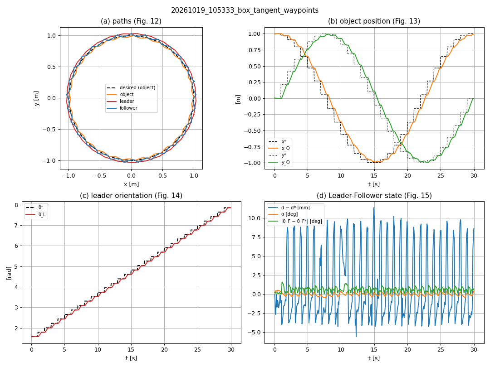

# Step 11 — Repeatability and Object Retention

## Objective

Step 10 reproduced the box columns of Table 2 with **one run per configuration**. In this step we
close the two remaining gaps of the reproduction:

1. **Repeatability.** Our simulation is deterministic: the same command gives exactly the same
   numbers every time, so "repeating" a run tells us nothing. We add realistic **measurement noise**
   to the pose feedback (a *virtual Vicon*) and run every configuration **5 times** with different
   random seeds. Now we can report **mean ± standard deviation**.
2. **Object retention.** The paper states that the object stays caged during the transport, but gives
   no number. We turn that claim into a measurable result: the largest distance of the object from
   the midpoint of the two robots during the lap, and a pass/fail **"retained"** per run.

**Scope** (decided by the author): box only; experiment 1 (static orientation) and experiment 2
(tangent orientation); the paper's waypoints and our smooth reference. The hemisphere, the pyramid and the leader-first
closure stay as student exercises (Step 10 exercise 5, Step 7 exercise 6); the `radial`
orientation was run once (Step 10, exercise 4) but is not repeated here.

## Paper reference

- §2.5 — poses measured with a Vicon system (6 cameras).
- §3, Table 2 — mean errors; no standard deviation, no number of runs.
- §3 — "the proposed Leader-Follower caging algorithm was capable of maintaining the object closure
  condition along the complete trajectory".

## Theory

### 1. Why add noise to get repeatability?

A simulation with the same inputs and the same initial state produces (practically) the same output:
our Step 10 runs repeated on two computers gave the same mean errors to the millimeter, so their
standard deviation would be about 0. That does not mean the result is
robust; it only means the computer is deterministic.

A real experiment changes from run to run because of measurement noise, wheel slip, communication
delays, etc. We add the **simplest** of these sources: the measurement noise of the motion-capture
system. Each run uses a different random **seed**, so each run sees a different noise sequence.

### 2. The virtual Vicon

$$
x_{\text{meas}} = x + n_x,\quad y_{\text{meas}} = y + n_y,\quad
\theta_{\text{meas}} = \theta + n_\theta,\qquad
n_x, n_y \sim \mathcal N(0, \sigma_{xy}^2),\quad n_\theta \sim \mathcal N(0, \sigma_\theta^2)
$$

We use $\sigma_{xy} = 2$ mm and $\sigma_\theta = 0.005$ rad ($\approx 0.3°$). The paper gives no
value; this is our assumption for a motion-capture system including small jitter (a Vicon is
usually more precise; exercise 1 explores larger values).

```
/<body>/ground_truth/odom ──► vicon node (+ noise, seed) ──► /<body>/vicon/odom     body = leader, follower, object
          │                                                          │
          │  EVALUATION reads the truth                              │  CONTROLLERS read the measurement
          ▼                                                          ▼
 trajectory_tracker (CSV), task_manager, safety_supervisor   lqr_controller ×2, leader_follower, approach_manager
```

**Why do the controllers and the evaluation read different topics?** In the real experiment the
controllers only know the Vicon measurement. We want to report how far the object *really* was from
its goal, so the CSV keeps using the ground truth. If the CSV used the noisy poses, part of the
"error" would just be the noise we added.

### 3. Mean ± standard deviation

For one configuration with $n$ runs, each run $j$ gives a mean error $\bar e_j$ (the Table 2 number of
that lap). We report

$$
\mu = \frac{1}{n}\sum_{j=1}^{n}\bar e_j,\qquad
s = \sqrt{\frac{1}{n-1}\sum_{j=1}^{n}(\bar e_j-\mu)^2}
$$

($s$ is the *sample* standard deviation, `statistics.stdev`). It tells how much the result changes
from run to run, not how much the error changes inside one lap.

### 4. Object retention

Every CSV row already contains `cage` = distance from the object center to the midpoint of the two
robots. Per run:

- **max cage** = the largest `cage` during the lap;
- **retained** = max cage < 0.05 m, the same limit at which `safety_supervisor` aborts the task
  ("cage lost").

A run that loses the object is aborted and writes **no CSV**, so the batch script also counts how
many runs reached `DONE`.

## Files created / changed

```
src/
├── caging_control/
│   ├── caging_control/core/noise.py       # NEW: make_generator(seed), noisy_pose(...)  (no ROS)
│   ├── caging_control/nodes/vicon.py      # NEW: virtual Vicon: ground truth + noise -> vicon/odom
│   ├── caging_control/nodes/lqr_controller.py, leader_follower.py, approach_manager.py
│   │                                      # + parameter pose_source ('ground_truth' | 'vicon')
│   ├── caging_control/tools/plot_results.py
│   │        # + groups repeated runs (mean ± std), max cage, retained, --no-plots, --runs-csv
│   ├── test/test_noise.py                 # NEW: 4 tests (zero noise, seeds, std, angle wrap)
│   └── setup.py                           # + executable "vicon"
└── caging_bringup/
    ├── launch/task.launch.py, two_robots.launch.py
    │        # + arguments vicon_noise_xy, vicon_noise_yaw, seed (default 0 = no noise, as before)
    ├── launch/caging.launch.py            # passes pose_source to leader_follower and approach_manager
    └── scripts/run_experiments.sh         # + REPEATS, NOISE_XY, NOISE_YAW, RESULTS, summary
docs/
├── steps/step_11_repeatability.md         # this guide
├── data/step11_repeat_noise_runs.csv      # one row per run (the 20 raw CSVs are 5.7 MB)
└── figures/step11_box_tangent_waypoints_noise_run1.png
```

With the default arguments (no noise) the `vicon` node is not started and every controller reads
the ground truth: Steps 1–10 behave exactly as before.

### How the launch arguments reach the nodes

`vicon_noise_xy`, `vicon_noise_yaw` and `seed` are declared in `task.launch.py`. A launch argument is
visible to every launch file it includes, so `two_robots.launch.py` (starts the `vicon` node and the
LQRs) and `caging.launch.py` (Leader-Follower, approach manager) read them without passing them
through `trajectory.launch.py`. Both files apply the same rule:
`pose_source = 'vicon' if noise > 0 else 'ground_truth'`.

## How to build and run

```bash
cd ~/caging_multirobot_ros2
colcon build && source install/setup.bash
colcon test --packages-select caging_control      # 32 tests

# One run with the GUIs and a noisy Vicon
ros2 launch caging_bringup task.launch.py auto_start:=true \
    vicon_noise_xy:=0.002 vicon_noise_yaw:=0.005 seed:=1

# Check who reads what
ros2 topic info -v /leader/vicon/odom
ros2 param get /leader_follower pose_source       # vicon

# The batch of this step: 4 configurations x 5 seeds, headless (about 40 min)
REPEATS=5 NOISE_XY=0.002 NOISE_YAW=0.005 RESULTS=results/repeat_noise \
    bash src/caging_bringup/scripts/run_experiments.sh

# Table with mean ± std and retention, and the small per-run summary file
ros2 run caging_control plot_results results/repeat_noise/*.csv --table --no-plots
ros2 run caging_control plot_results results/repeat_noise/*.csv --no-plots --runs-csv runs.csv
```

## Results

Batch of 20261019: 4 configurations × 5 runs, seeds 1–5,
$\sigma_{xy} = 2$ mm, $\sigma_\theta = 0.005$ rad. **20 of 20 runs reached `DONE`.**
Per-run values: [docs/data/step11_repeat_noise_runs.csv](../data/step11_repeat_noise_runs.csv).

### Table 2 with repetitions (box, mean ± std over 5 runs)

| Configuration | $e_{d_O}$ [m] | $e_{x_O}$ [m] | $e_{y_O}$ [m] | $e_{\theta_L}$ [rad] | $e_d$ [m] | $e_{\theta_F}$ [rad] | $e_\alpha$ [rad] | max cage [mm] | retained |
|---|---|---|---|---|---|---|---|---|---|
| Exp. 1 static, waypoints | 0.103 ± 0.001 | 0.066 ± 0.000 | 0.066 ± 0.001 | 0.002 ± 0.000 | 0.003 ± 0.000 | 0.002 ± 0.000 | 0.008 ± 0.001 | 17.5 | 5/5 |
| Exp. 1 static, smooth | 0.048 ± 0.001 | 0.031 ± 0.001 | 0.031 ± 0.001 | 0.002 ± 0.000 | 0.001 ± 0.000 | 0.002 ± 0.000 | 0.004 ± 0.000 | 10.5 | 5/5 |
| Exp. 2 tangent, waypoints | 0.106 ± 0.001 | 0.068 ± 0.000 | 0.068 ± 0.000 | 0.070 ± 0.000 | 0.003 ± 0.001 | 0.010 ± 0.000 | 0.003 ± 0.000 | 13.9 | 5/5 |
| Exp. 2 tangent, smooth | 0.048 ± 0.002 | 0.031 ± 0.002 | 0.031 ± 0.001 | 0.045 ± 0.000 | 0.001 ± 0.000 | 0.002 ± 0.000 | 0.001 ± 0.000 | 13.3 | 5/5 |
| *Paper, exp. 1 (box)* | 0.10 | 0.07 | 0.06 | 0.08 | 0.01 | 0.09 | 0.06 | – | – |
| *Paper, exp. 2 (box)* | 0.13 | 0.09 | 0.07 | 0.15 | 0.01 | 0.10 | 0.09 | – | – |

### Without noise (Step 10, one run, for comparison)

| Configuration | $e_{d_O}$ | $e_{\theta_L}$ | $e_d$ | $e_\alpha$ | max cage [mm] | retained |
|---|---|---|---|---|---|---|
| Exp. 1 static, waypoints | 0.103 | 0.000 | 0.003 | 0.007 | 14.8 | 1/1 |
| Exp. 1 static, smooth | 0.047 | 0.000 | 0.000 | 0.003 | 4.2 | 1/1 |
| Exp. 2 tangent, waypoints | 0.105 | 0.069 | 0.003 | 0.003 | 9.7 | 1/1 |
| Exp. 2 tangent, smooth | 0.046 | 0.045 | 0.001 | 0.000 | 4.3 | 1/1 |



### Discussion

1. **The results are repeatable.** Over 5 noisy runs the object position error changes by about
   1–2 mm ($s \le 0.002$ m), much less than the error itself. The object-position errors stay the
   same as without noise (0.103–0.106 m with waypoints, 0.046–0.048 m with the smooth reference),
   and with the paper's waypoints they match the paper in experiment 1 (0.103 vs 0.10 m) and
   stay below it in experiment 2 (0.106 vs 0.13 m).
2. **The object is always retained.** 20/20 runs finished, and the object never moved more than
   17.5 mm from the midpoint of the robots (35 % of the 50 mm limit). The noise increases the worst
   case (smooth reference: from about 4 mm to 10–13 mm), but the cage holds with a large margin:
   this is the quantitative version of the paper's qualitative claim.
3. **This noise does not explain the paper's larger orientation and formation errors.** With
   $\sigma_\theta \approx 0.3°$, $e_{\theta_L}$ (static) only grows from 0.000 to 0.002 rad and
   $e_\alpha$ stays below 0.01 rad, while the paper reports 0.06–0.15 rad. The remaining difference
   must come from what the simulation does not contain: mecanum roller slip, motor dynamics, WiFi
   delays (see the Discussion of Step 10).
4. **What the standard deviation does *not* include.** Only the measurement noise changes between
   runs; the initial poses, the object mass and friction, and the robot dynamics are identical. A
   real experiment would have a larger spread.

## Exercises

1. Run one configuration with 5× more noise (`vicon_noise_xy:=0.01 vicon_noise_yaw:=0.025`). Does the
   object stay retained? Which error grows first: $e_{d_O}$, $e_d$ or $e_\alpha$? Why?
2. Increase the noise until a run is aborted ("cage lost"). Which controller is the most sensitive:
   the LQR of the leader or the Leader-Follower? (Hint: plot `/formation_error`.)
3. Run the same seed twice. Are the two CSV files identical? What does that tell you about the
   simulation?
4. Change `plot_results` to report the **worst run** instead of the mean for each configuration.
   When is the worst case more useful than the mean ± std?
5. The CSV is written from the ground truth. Modify a copy of `trajectory_tracker` to log the
   `vicon/odom` poses instead and compare the errors. What part of the "error" is only noise?
6. Add a second source of variation: small random changes of the initial robot poses (±2 cm). Is
   the standard deviation still about 1 mm?
7. (From Step 10) Run the hemisphere and the pyramid with 5 noisy runs each and complete the
   remaining columns of Table 2.
